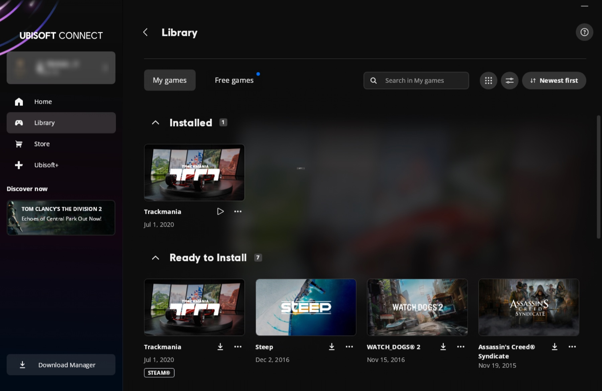
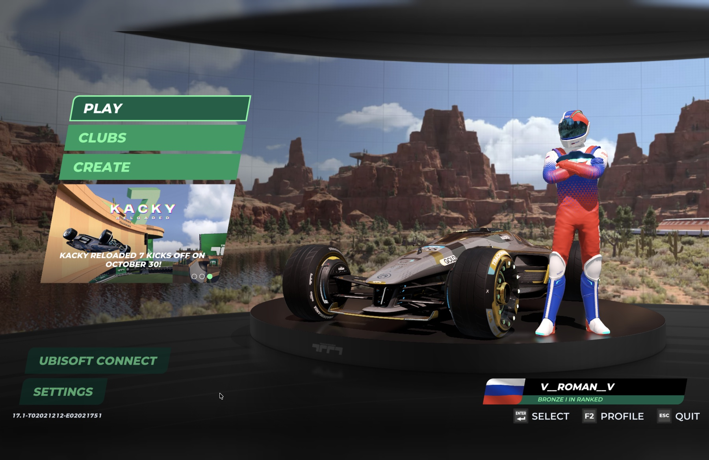
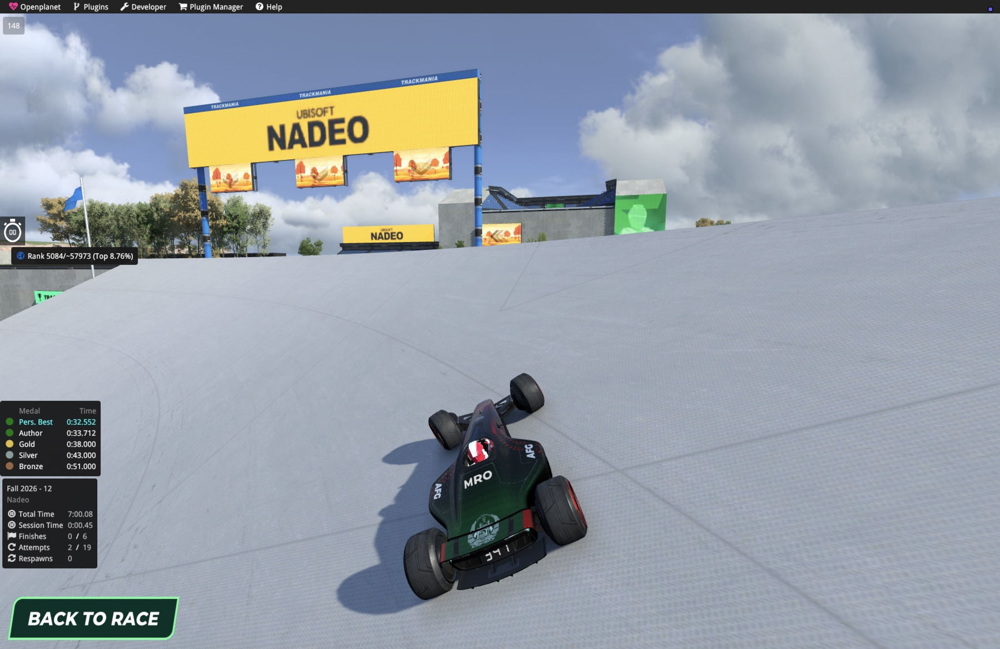
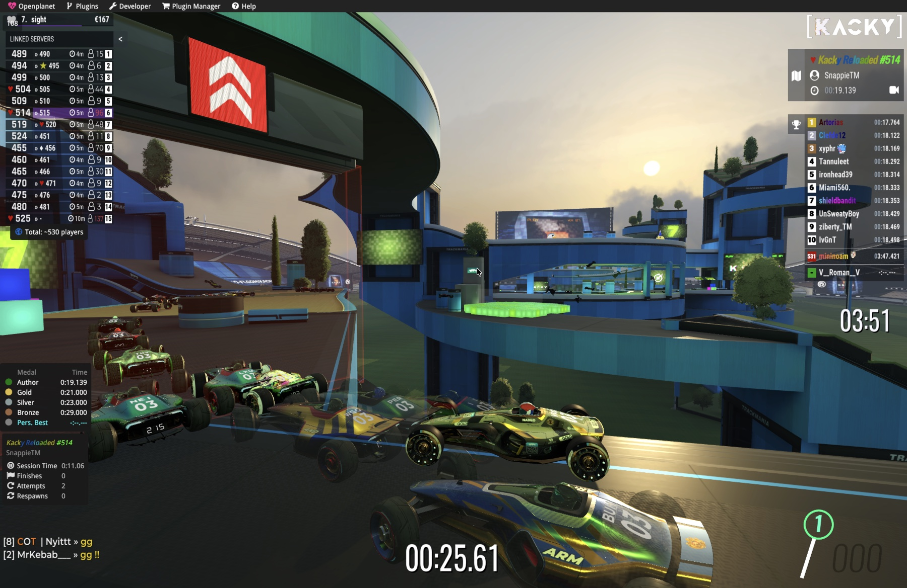

# Trackmania 2020 for Apple Silicon Macs

Play Trackmania (2020) on a Mac with an M-series chip. This free, open-source project runs Ubisoft Connect and the game through Wine, with fixes for Apple's graphics and some speed-ups of its own. Sign-in, online races and [Openplanet](https://openplanet.dev) with its plugins all work.

For TrackMania Nations Forever and other Trackmania games, see [TrackMania-MacOS](https://github.com/vakesz/TrackMania-MacOS). This project was inspired by it and uses some of its Wine patches.

<table>
  <tr>
    <th width="50%">Ubisoft Connect</th>
    <th width="50%">Main menu</th>
  </tr>
  <tr>
    <td></td>
    <td></td>
  </tr>
  <tr>
    <th>In a race, with Openplanet</th>
    <th>On an online server</th>
  </tr>
  <tr>
    <td></td>
    <td></td>
  </tr>
</table>

## What works

| Part | Status |
| --- | --- |
| Ubisoft Connect | Opens, signs in, downloads and updates the game |
| The game | Draws correctly on Apple's Metal |
| Frame rate | Median 123 FPS in fullscreen at 1800×1169, see [Frame rate](#frame-rate) |
| Online races | Work, with free Starter access and with Club access |
| Openplanet | Works, with plugins from its Plugin Manager. One command installs it |
| Fullscreen | Works on the Mac's own display. While an external display is connected, the game stays in a window |

So far this has been tested on one Mac, a MacBook Pro with M5 Pro and macOS 27. It should work on any Apple Silicon Mac, probably with a lower frame rate on smaller chips. If you try it on another Mac, please [tell me how it went](https://github.com/V-Roman-V/Trackmania2020-MacOS/issues), even if everything works.

## What this project solves

A standard Wine setup doesn't get far with Trackmania on a Mac. These are the problems this project had to solve:

- **Signing in.** Ubisoft's sign-in page answers "Access is temporarily restricted" to Connect on Wine. Here it lets you in. Please read [About the sign-in](#about-the-sign-in) to see how.
- **Ubisoft Connect itself.** Its window stayed blank, and its web pages crashed under Rosetta. Two Wine patches and one of its settings fix both.
- **Correct graphics.** Metal rejected 33 of the game's graphics pipelines, so levels had no ground. Metal also has no geometry shaders, which two of the game's lighting passes need. Patches to DXVK fix both, and every pixel, vertex and compute shader in the game's shader cache, 4,847 of them, now compiles on Metal.
- **Openplanet.** Openplanet loads under Wine and Rosetta, with plugins from its Plugin Manager. `tm2020 openplanet` installs it into the game's folder, which it finds by itself. See [Openplanet](#openplanet).
- **Speed.** Connect kept redrawing its window behind the game, which cost more than a whole CPU core, and now it rests while you play. DXVK's calls into Wine now go across in batches. On the same map, that raised the median from 119 to 124 FPS, and the frame rate held 90% of the time from 107 to 114 FPS. Two smaller changes take another 0.4 ms of work per frame off the game's busiest thread.
- **No paid software.** You don't need CrossOver or any other paid tool. Everything is built from public source code, and you can build it yourself.

## Frame rate

| Display | Settings | Frame rate |
| --- | --- | --- |
| Fullscreen, 1800×1169 | Shadows High, 4x MSAA, capped at 150 | Median 123 FPS over 36 minutes, and 106 FPS or more 90% of the time. Each map's median was between 113 and 149 |

Measured on the same Mac. The [development notes](docs/development.md#metrics) have more measurements and how they were taken.

## What you need

- A Mac with Apple Silicon, M1 or newer. Intel Macs are not supported.
- macOS 14 Sonoma or newer.
- About 10 GB of free disk space. The game takes 6.4 GB.
- A Ubisoft account with Trackmania access, free Starter or Club.

## Install

Run in Terminal:

```sh
/bin/bash -c "$(curl -fsSL https://raw.githubusercontent.com/V-Roman-V/Trackmania2020-MacOS/main/install.sh)"
```

The script installs Rosetta 2 if it is missing, the runtime from this project's GitHub release (about 110 MB) and Ubisoft Connect (about 250 MB), and adds the Trackmania 2020 app. It takes a few minutes.

<details>
<summary>What the installer puts on your Mac</summary>

| What | Where |
| --- | --- |
| The Trackmania 2020 app | `/Applications`, or `~/Applications` if you can't write to `/Applications` |
| Ubisoft Connect and the game, in their own Windows folder (a Wine prefix) | `~/Games/TM2020` |
| The runtime (Wine, DXVK, MoltenVK) and the launcher scripts | `~/Library/Application Support/Trackmania2020` |
| Ubisoft Connect's installer | `~/Library/Caches/Trackmania2020` |
| Game settings, maps and replays, the same as on Windows | `~/Documents/Trackmania` |

The runtime comes from this project's [GitHub release](https://github.com/V-Roman-V/Trackmania2020-MacOS/releases), and the installer checks its SHA-256 checksum before using it. Ubisoft Connect comes straight from Ubisoft. Rosetta 2 is Apple's translator for programs made for Intel Macs, which Wine needs.

</details>

## Play

1. Open the Trackmania 2020 app, which starts Ubisoft Connect.
2. Read [About the sign-in](#about-the-sign-in), then sign in with your Ubisoft account.
3. Install Trackmania in Connect and press Play.
4. Optionally, add Openplanet: download its installer and run one command, see [Openplanet](#openplanet).

- **Fullscreen.** Disconnect any external display before you start the game, then choose Fullscreen in the game's display settings. While an external display is connected, the game stays in a window.
- **Missing parts for a moment.** The first time you visit a map, the game's shaders are prepared in the background, and some parts can be missing for a second. That goes away by itself.
- **Your files.** Settings, maps and replays are in `Documents/Trackmania`, the same as on Windows.

## About the sign-in

Please read this before you sign in.

Ubisoft protects its sign-in page with a service called DataDome, which turns Connect on Wine away with "Access is temporarily restricted". It looks at which graphics card the page's WebGL reports.

To get through, the browser inside Ubisoft Connect reports an **AMD Radeon RX 6800 XT** instead of your Mac's graphics. The [MetalSharp](https://github.com/metalsharp/MetalSharp) project worked out this approach. Only Connect's browser sees that card, and the game uses your Mac's real graphics.

Reporting hardware you don't have to pass a security check is your own decision, and at your own risk, including any risk to your Ubisoft account. It has worked with the accounts tried so far, with both Starter and Club access, but there is no guarantee.

## Openplanet

[Openplanet](https://openplanet.dev) adds plugins and tools to the game, and it works here. Version 1.29.14 was tested. To install it:

1. Download Openplanet's installer for Trackmania from [openplanet.dev](https://openplanet.dev/download). If you downloaded it before, delete the older file from Downloads.
2. Quit the game and Ubisoft Connect.
3. Run:

   ```sh
   "$HOME/Library/Application Support/Trackmania2020/launcher/bin/tm2020" openplanet ~/Downloads/OpenplanetNext_*.exe
   ```

4. Start the game. F3 (fn F3 on most Mac keyboards) opens Openplanet.

Install it again after each game update. With Starter access, Openplanet only loads signed plugins.

## Update

Run the same install line again. The game, your sign-in and your settings stay. Ubisoft Connect and the game keep themselves up to date, as on Windows.

## Uninstall

Run this and confirm with `yes`:

```sh
"$HOME/Library/Application Support/Trackmania2020/launcher/bin/tm2020" uninstall
```

This removes Ubisoft Connect, the game, the runtime and the app. Your settings, maps and replays in `Documents/Trackmania` stay.

## Troubleshooting

**Connect says "Unable to start download (Code: 17004)".** This is usually the network. Some school and office networks block Ubisoft's download server. This command checks yours:

```sh
"$HOME/Library/Application Support/Trackmania2020/launcher/bin/tm2020" check-download
```

If it says `BLOCKED`, download the game on another network. Game updates come from the same server, so they need such a network too.

**"Access is temporarily restricted" at sign-in.** Read [About the sign-in](#about-the-sign-in) first. If you saw this page before, Connect's browser data may be flagged. Quit Connect, run this, and open the app again. Your games are not affected.

```sh
cd ~/Games/TM2020/prefix/drive_c/users/"$(id -un)"/AppData/Local/"Ubisoft Game Launcher"/cache && mv http2 http2.old
```

**The game stays in a window.** Disconnect external displays before you start the game.

**The app says "Trackmania 2020 could not start".** The message says why. Running the install line again fixes most problems.

**Something else.** Please [open an issue](https://github.com/V-Roman-V/Trackmania2020-MacOS/issues/new/choose). The logs are in `~/Games/TM2020/logs`. Connect's log can contain account details and download links, so look through it before you share it.

## Questions

**Is it free?** This project is free and open source. Trackmania's Starter access is free too, and Club is a paid subscription from Ubisoft. Your Ubisoft account decides which one you have, and both work the same way here.

**Is this official?** No. It is an independent community project, not affiliated with Nadeo or Ubisoft. Ubisoft Connect and the game download from Ubisoft, and you sign in with your own account. Nothing of theirs is in this repository.

**Can I build it myself?** Yes. The [development notes](docs/development.md) explain how to build the runtime from source, and everything else about how this works.

## For developers

- [Development notes](docs/development.md): what was tested and how, every command, the performance work and all measurements.
- [Building](docs/building.md): how the runtime is built from pinned sources, and how a release is packed.
- [Runtime](docs/runtime.md): each patch, why it is there, and the known limits.
- [Contributing](.github/CONTRIBUTING.md)

## Thanks

This project stands on other people's hard work. With gratitude to:

- [TrackMania-MacOS](https://github.com/vakesz/TrackMania-MacOS) for the way to build Wine on Apple Silicon that this build follows, and for five of the Wine patches.
- [Wine](https://www.winehq.org) for the Windows compatibility layer everything here is built on.
- [DXVK](https://github.com/doitsujin/dxvk) and the [d9vk fork](https://github.com/Sikarugir-App/d9vk) for turning Direct3D into Vulkan.
- [MoltenVK](https://github.com/KhronosGroup/MoltenVK) for running Vulkan on Apple's Metal.
- Apple's Rosetta 2 for translating the x86 code on Apple Silicon.
- [MetalSharp](https://github.com/metalsharp/MetalSharp) for working out the sign-in workaround.
- Porting Kit, whose Wine build showed the mode switch that works under Rosetta.
- [Openplanet](https://openplanet.dev) for its plugin platform.
- Nadeo and Ubisoft for Trackmania itself.

## License

This project's own scripts, tests and tools use the MIT license. Patches keep the license of the code they change. See [LICENSE](LICENSE).

Trademarks and game content belong to their owners. This is an unofficial community project, not affiliated with Nadeo or Ubisoft.
